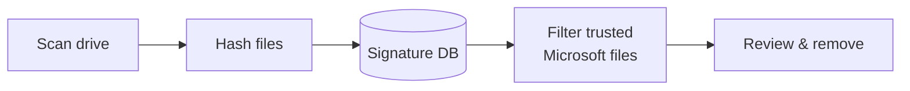

<div align="center">


# NexuShield AntiVirus

**A Windows desktop security suite built in Python, bringing malware scanning, firewall control, USB protection and system cleanup into one interface.**


</div>


---

## Features

**False-positive protection:** Matches that are genuine, Microsoft-signed Windows files are filtered out automatically. 

**Virus Scan:** Scans the system drive and checks files against **1.1M+ known malware signatures** from MalwareBazaar, then lets you review and remove matches. 


**Firewall:** View, create and delete inbound and outbound firewall rules. 


**USB Protection:** Blocks USB storage by default, with per-device enable/disable. 


**Junk Cleaner:** Clears temporary files, caches and other system clutter. 


## How detection works



1. **Scan:** files are fingerprinted with MD5, SHA-1 and SHA-256 using multiple threads.
2. **Match:** fingerprints are checked against a MySQL database of known malware.
3. **Verify:** matches with a valid Microsoft signature are treated as false positives.
4. **Act:** the remaining matches are listed for review before anything is deleted.

## Skills demonstrated

**Security**
- Signature-based malware detection and cryptographic hashing
- Integrating a real-world threat-intelligence feed (MalwareBazaar)
- Handling false positives through code-signature verification
- Host hardening: firewall rules and removable-media control

**Software engineering**
- Modular design, with one module per feature
- Multithreading, with a responsive UI during long-running scans
- Resilient error handling: unreadable files are logged and skipped, not fatal
- Batched database queries for large signature sets

**Systems and tooling**
- Integrating Python with Windows system tools and APIs
- Automated setup: dependency installer and database loader scripts
- Debugging real platform issues, such as long paths and certificate validation

## Project structure

```text
├── avav.py           # Main window and navigation
├── hashav.py         # File scanner and hashing
├── qav.py            # Signature lookup, trust check, removal UI
├── fwav.py           # Firewall management
├── usbav.py          # USB protection
├── diskav.py         # Junk cleaner
├── setup_db.py       # Creates the database and loads signatures
├── check_file.py     # Diagnostic: explains why a file is or isn't detected
├── install.ps1       # One-step dependency installer
└── requirements.txt
```

## Upcoming Updates

- [ ] Quarantine (move and restore) instead of permanent deletion
- [ ] Real-time file monitoring
- [ ] Heuristic / YARA-based detection
- [ ] Package as a standalone `.exe`

## Acknowledgements

Malware signatures provided by [MalwareBazaar](https://bazaar.abuse.ch/) (abuse.ch).

---

<div align="center">

Built by **Sebastian Kolesnik** · © 2025

</div>
